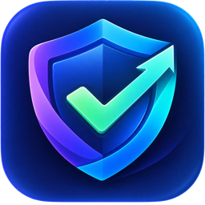
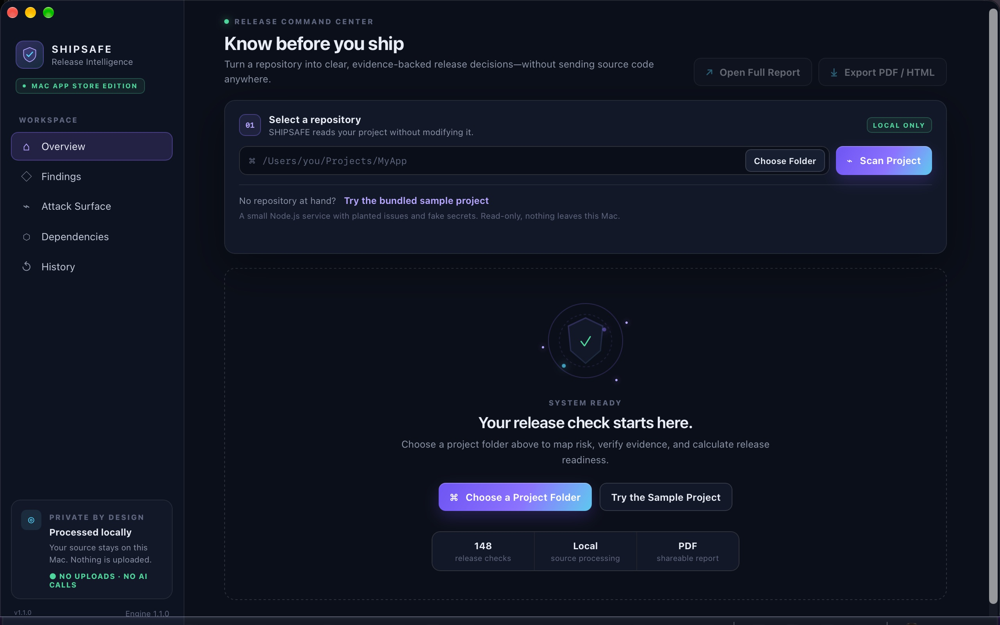
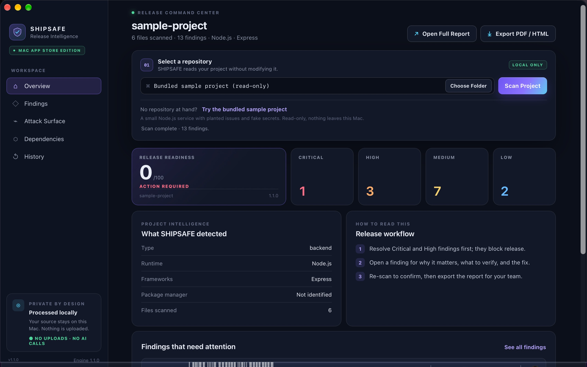
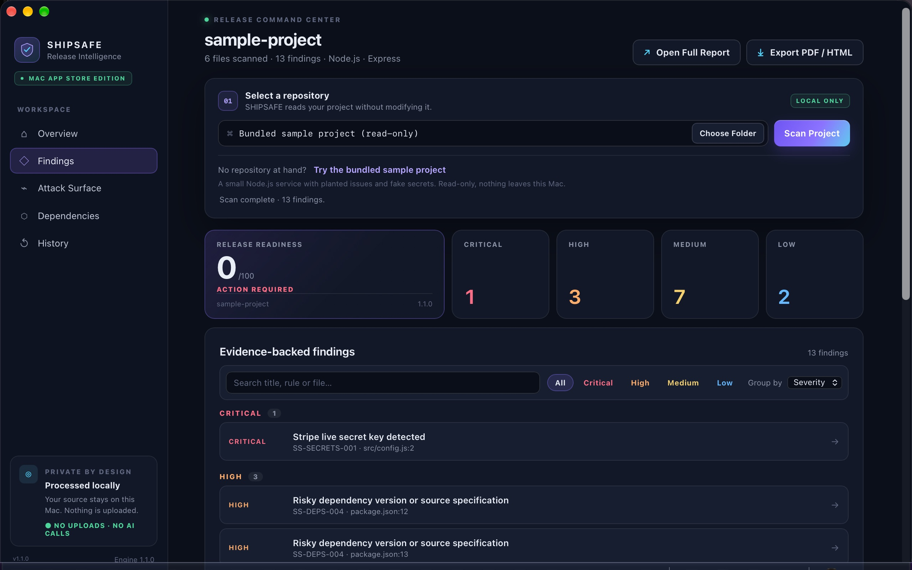
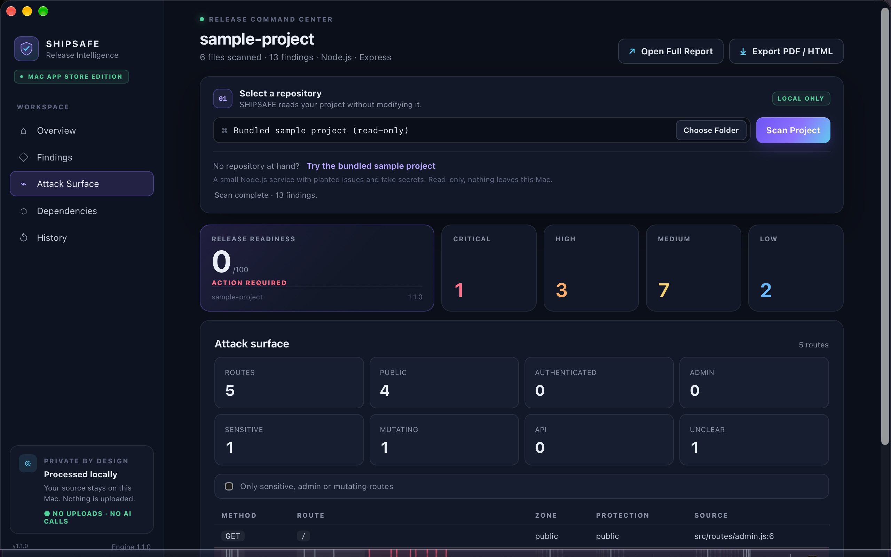
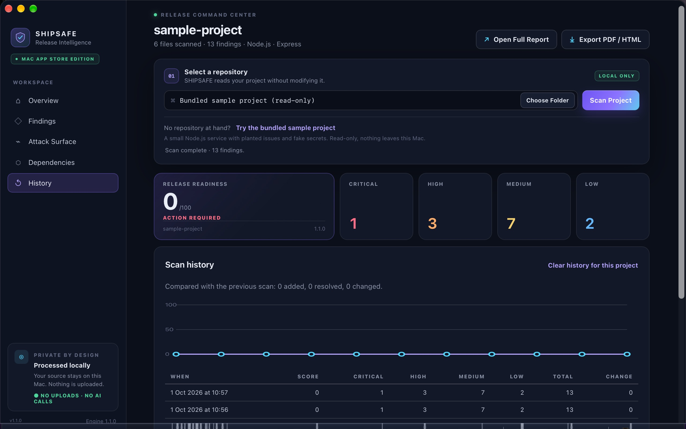
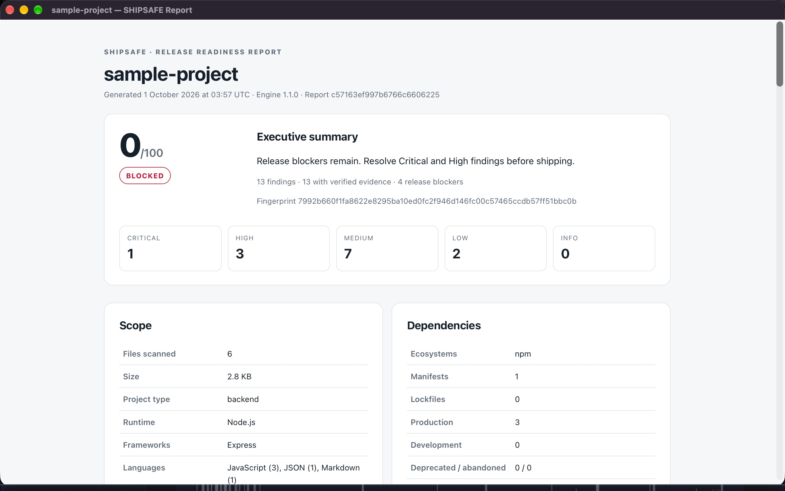

<div align="center">



# SHIPSAFE

### Catch leaked API keys, debug leftovers and unprotected routes *before* you ship.

A native Mac app for iOS, Mac and backend developers. Point it at a project folder and get a release-readiness score in seconds, with the file, the line and the fix for every finding. **Your code never leaves your Mac.**

[](https://apps.apple.com/us/app/shipsafe-release-readiness/id6808833747?mt=12)

**$9.99 once.** No subscription. No account. No upload. No AI calls.


[▶ Watch the 30-second demo (MP4)](media/shipsafe-demo-30s.mp4) · [📋 Free pre-release checklist](RELEASE-CHECKLIST.md)

</div>

---

## Friday, 5:58 PM

The build is green. The tests pass. You're about to push.

And somewhere in the repo there's still a `sk_live_` Stripe key, an `OPENAI_API_KEY` pasted into a Swift file "just for testing", a `DEBUG = true` in the backend config, and an `/admin` route with no auth check.

Tests don't catch these. Code review often misses them. **SHIPSAFE finds them in seconds, on your Mac.**

## Why this matters for Apple developers

**Anything compiled into your app can be extracted.** Running `strings` on a downloaded `.ipa` or `.app` is enough to pull out a hardcoded key. Then someone else is spending your OpenAI credits, or reading your Stripe account.

Most apps also ship with a backend, a web dashboard, a webhook server or cloud functions. That's where an unprotected route or a debug flag turns into a breach. SHIPSAFE reviews the **whole project folder**, app and backend together.

- 🔑 **Leaked keys and secret files.** OpenAI, Stripe live, AWS, GitHub, Google and Slack keys, private keys, and committed `.env`, `credentials.json` or `service-account.json` files. It reads `.swift`, `.plist`, `.xcconfig`, JSON, YAML and every other text file.
- 🧹 **Leftovers from development.** TODO and FIXME markers in Swift, Kotlin, JS/TS, Python, Go, Rust and more. Debugger statements and debug dumps in backend code. Development-only config.
- 🚪 **Your backend's attack surface.** Every route, whether it's public, authenticated or admin, and which ones change data without protection. Error pages that leak stack traces.
- 📦 **Dependencies.** Missing lockfiles, wildcard or `latest` versions, git-branch specs and other supply-chain signals.
- 🗄️ **Destructive migrations.** `DROP`, `TRUNCATE` and unguarded deletes that can wipe production data.
- 🔒 **Private by design.** No account, no telemetry, no AI. Under NDA or working on an unreleased app? That's exactly who it's built for.

## What a finding looks like

Every finding is evidence, not a vague warning:

```text
CRITICAL  Stripe live secret key detected                    SS-SECRETS-001
          src/config.js:2

Why it matters
  A token in a known provider format (Stripe, AWS, GitHub, Slack…) works the
  moment someone reads it. Anyone with repository, CI log or backup access can
  act as your account until the key is revoked.

What to verify
  Confirm the value is live or was ever live. Even if it is a test key, check
  whether the same file ever held a production value in git history.
```

Then reveal it in Finder, open it in your editor, or copy it as Markdown into an issue.

## What you get

| | |
|---|---|
| **Release-readiness score** | One score out of 100 and a clear release status for the whole project. |
| **Evidence-backed findings** | Grouped by severity, searchable and filterable, each with the exact file and line. |
| **Explanations written for humans** | For all 148 checks: why it matters, what to verify, how to fix it. |
| **Attack-surface map** | Routes, protection level, sensitive and admin endpoints. |
| **Dependency posture** | Manifests, lockfiles, risky specs, supply-chain signals. |
| **Scan history** | A readiness trend per project, so you can see each release get safer. |
| **Professional report** | Export as PDF or HTML for your team, your client or your reviewer. |
| **Mac-native** | Native menus and shortcuts, light and dark mode, sandboxed scanning engine. |

## Screenshots

| | |
|---|---|
|  |  |
| **Pick a folder, or try the bundled sample** | **Release readiness score and severity breakdown** |
|  |  |
| **Every finding with evidence and a fix** | **Attack-surface map of your routes** |
|  |  |
| **Readiness trend across scans** | **Shareable PDF / HTML report** |

## How it compares

| | SHIPSAFE | Typical cloud code scanner |
|---|:---:|:---:|
| Your source code leaves your machine | **Never** | Uploaded or connected to their servers |
| Account required | **No** | Yes |
| Pricing | **$9.99 once** | Monthly subscription |
| Works offline | **Yes** | No |
| Plain-language fix for every finding | **Yes** | Varies |
| Native Mac app | **Yes** | Web dashboard |

## Try it in under a minute

1. [Get SHIPSAFE on the Mac App Store](https://apps.apple.com/us/app/shipsafe-release-readiness/id6808833747?mt=12).
2. Click **Try the Sample Project**. It's a small Node.js service with planted issues and fake secrets.
3. Read the findings, then point SHIPSAFE at your own project.

SHIPSAFE only reads your project. It never modifies it.

## When to run it

- Before you **Archive** and upload to TestFlight or App Store Connect.
- Before you **deploy** the backend your app talks to.
- Before you **hand over** a project to a client.
- Before you **open-source** a repo that used to be private.

Want the full list? See the free **[pre-release security checklist for iOS and Mac developers](RELEASE-CHECKLIST.md)**.

## FAQ

**Does it upload my code anywhere?**
No. Scans run entirely on your Mac inside a sandboxed engine. There's no account, no telemetry and no call to any AI service. Scan history stays in the app's own container.

**What languages and stacks does it understand?**
Secret detection runs on every text file, including Swift, plist, xcconfig, JSON and YAML. Leftover-code checks cover Swift, Kotlin, Java, JavaScript/TypeScript, Python, PHP, Ruby, Go, Rust and web files. Route, dependency and database checks go deepest on JavaScript/TypeScript backends such as Node.js and Express.

**Does it check my Xcode project against App Review guidelines?**
Not today. SHIPSAFE focuses on secrets, leftovers, backend routes, dependencies and migrations. Tell us which Apple-specific checks you want in [issues](https://github.com/ilyasaalmadani/shipsafe-macos/issues/new/choose).

**Does it guarantee a secure app?**
No tool can. SHIPSAFE is a release-review assistant. Automated findings can include false positives or miss context. Review the evidence and make the final call yourself.

**Requirements?**
An Apple silicon Mac running macOS 13 or later.

**Is the source code here?**
No. SHIPSAFE is a commercial app. This repository holds the demo, the screenshots, the checklist, and the place to talk to us.

## Feedback and feature requests

[Open an issue](https://github.com/ilyasaalmadani/shipsafe-macos/issues/new/choose) to report a false positive, ask for a new check, or request support for your stack. Every request is read, and the most-requested checks ship first.

Support by email: [support@jijilabsdigital.com](mailto:support@jijilabsdigital.com)

**If SHIPSAFE caught something before you shipped it, a ⭐ on this repo helps other developers find it.**

## Links

- Mac App Store: https://apps.apple.com/us/app/shipsafe-release-readiness/id6808833747?mt=12
- Website: https://jijilabsdigital.com/#shipsafe
- Privacy policy: https://shipsafe.lagirame.id/privacy

---

<div align="center">

Ilyas A. Almadani · PT Jiji Labs Digital<br>
© 2026 PT Jiji Labs Digital. All rights reserved.

</div>
